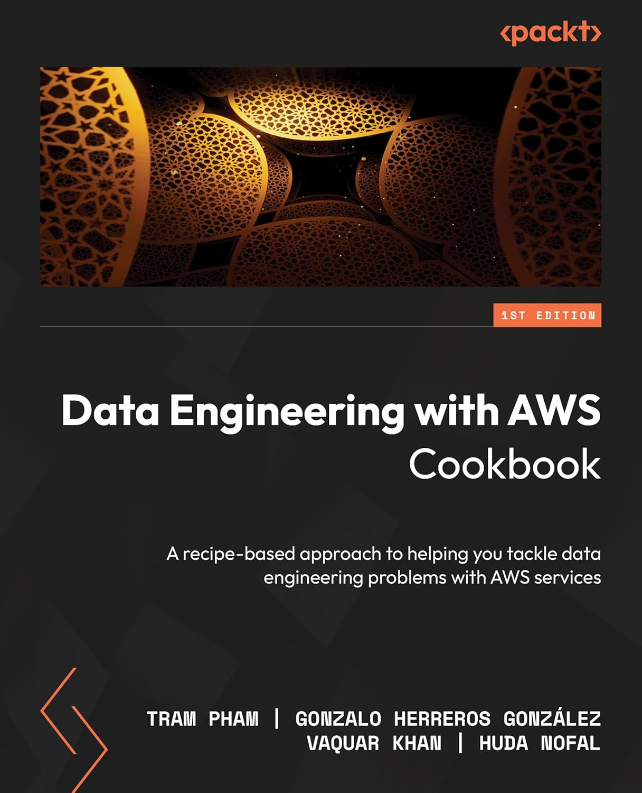

<div align="center">


## **Senior Data Architect @ AWS Professional Services**

<sub>*Also known as: Vaquar Khan | Viquar Khan*</sub>

### AWS | GCP | AZURE | PCF | Microservices | Big Data | Apache Spark | GenAI & Agentic AI | ML/AI SME | Polyglot Developer | Architect | Technology Evangelist

<p align="center">
  
</p>

[](https://www.linkedin.com/in/vaquar-khan-b695577/)
[](https://stackoverflow.com/users/4812170/vaquar-khan)
[](https://orcid.org/0009-0008-3592-4162)
[](https://arxiv.org/abs/2608.14643)
[](#-orcid-arxiv-and-zenodo)
[](https://scholar.google.com/citations?user=PfD241cAAAAJ)
[](#-400000-pypi-downloads)
[](https://github.com/vaquarkhan)
[](https://www.infoq.com/articles/architecting-cloud-native-kafka/)
[](https://adplist.org/mentors/vaquar-khan)


</div>

---

<div align="center">


## 📦 400,000+ PyPI downloads

**426,709** all-time downloads across MCP-Bastion and MCP Test Harness. PePy total, summed across every package.

| Product | Packages | PePy all-time total | Snapshot |
|---------|----------|---------------------|----------|
| [MCP-Bastion](https://github.com/vaquarkhan/MCP-Bastion) | 26 | **216,483** | [24 Oct 2026](https://raw.githubusercontent.com/vaquarkhan/MCP-Bastion/main/docs/site/assets/ecosystem-downloads.json) |
| [MCP Test Harness](https://github.com/vaquarkhan/mcp-test-harness) | 26 | **210,226** | [12 Aug 2026](https://raw.githubusercontent.com/vaquarkhan/mcp-test-harness/main/html/assets/ecosystem-downloads.json) |
| **Combined** | **52** | **426,709** | |

This is a sum of package downloads. Installing an integration also downloads the core package, so it is not 400,000 unique installs.

</div>

---

<div align="center">


## 🔬 ORCID, arXiv, and Zenodo

| Record | What it is | Link |
|--------|------------|------|
| **ORCID** | Viquar Khan, `0009-0008-3592-4162` | [orcid.org/0009-0008-3592-4162](https://orcid.org/0009-0008-3592-4162) |
| **arXiv:2608.14643** | *Proof-Gated Publication: Verify-Before-Commit Content Integrity for Serverless Data-Mesh Lakehouses* (11 Aug 2026) | [abs](https://arxiv.org/abs/2608.14643) · [pdf](https://arxiv.org/pdf/2608.14643) · [DOI](https://doi.org/10.48550/arXiv.2608.14643) |
| **Zenodo — Fulcrum / RVx** | *Fulcrum: Quantitative, Governed Granularity for Microservice Boundaries with the RVx Index* | [10.5281/zenodo.23284522](https://doi.org/10.5281/zenodo.23284522) |
| **Zenodo — Microservices Recipes** | *Microservices Recipes: The Architect's Field Guide* | [10.5281/zenodo.22654421](https://doi.org/10.5281/zenodo.22654421) |
| **Zenodo — Mobility** | *Decentralized Mobility-Based Loyalty Systems* | [10.5281/zenodo.22273115](https://doi.org/10.5281/zenodo.22273115) |
| **Fulcrum / RVx** | Research site for the granularity paper | [vaquarkhan.github.io/fulcrum-rxy](https://vaquarkhan.github.io/fulcrum-rxy/) |

</div>

---


## 🚀 About Me

**Va<sub><sup>i</sup></sub>quar Khan** - Senior Data Architect at **AWS Professional Services** in Chicago, IEEE Senior Member, with work in finance and data since 2004. Public roles run through HSBC, JPMorgan, Citi, CNA, and Synchrony, then AWS since August 2021. I design data, analytics, and GenAI systems for financial-industry customers, including capital markets, tri-party collateral, and enterprise data lakes.

As a **polyglot developer** skilled in Java, Scala, Python, and other languages, I specialize in large-scale distributed systems, cloud architecture, big data development, **Generative AI & Agentic AI solutions** using Amazon Bedrock, and **AWS AI/ML solutions** for highly competitive enterprise clients. On [Stack Overflow](https://stackoverflow.com/users/4812170/vaquar-khan) the profile shows reputation **11,539**, about **7.5 million people reached**, **7 gold / 83 silver / 104 bronze** badges, and **2,918** days visited. [GitRanks](https://gitranks.com/profile/vaquarkhan/ranks) places the profile in **Legend 1, the top 1% worldwide**, by stars (**#15,694 of 1,669,787**, 2,667 stars) and by followers (**#12,955 of 2,527,903**, 719 followers). That is a third-party tier, checked 18 Oct 2026. It is not an official GitHub rank, and it is not a claim to be the single #1 account.

<div align="center">

### ⚡ At a Glance

| | |
|---|---|
| 📦 **[400,000+ PyPI downloads](#-400000-pypi-downloads)** | **426,709** PePy downloads · MCP-Bastion 216,483 · MCP Test Harness 210,226 · 52 packages |
| 📦 **[10 Published Packages](#-published-packages)** | [PyPI](https://pypi.org/project/sparkrules/) · [Maven Central](https://central.sonatype.com/artifact/io.github.vaquarkhan/aiv-gate) · [npm](https://www.npmjs.com/package/@mcp-bastion/core) · [Docker GHCR](https://ghcr.io/vaquarkhan/iceguard) |
| 🔐 **[The Vaquar Pattern (PVDM)™](https://github.com/vaquarkhan/CogniMesh/blob/main/docs/vaquar-pattern.md)** | Original data integrity architecture for serverless data mesh |
| 🧩 **[The Khan Microservices Pattern™](https://github.com/vaquarkhan/microservices-recipes-a-free-gitbook)** | Adaptive Granularity for distributed systems — 609 ⭐ · 225 forks |
| 📝 **[Kafka KIPs + Spark proposals](#authored-proposals)** | [KIP-1267](https://cwiki.apache.org/confluence/display/KAFKA/KIP-1267%3A+Tiered+Storage+Cost+Attribution+Metrics) · [KIP-1316](https://cwiki.apache.org/confluence/x/I5E8G) · [KIP-1317](https://cwiki.apache.org/confluence/x/JZE8G) · [KIP-1318](https://cwiki.apache.org/confluence/display/KAFKA/KIP-1318%3A+Model+Context+Protocol+%28MCP%29+Server+for+Apache+Kafka) · [KIP-1150 discussion](https://www.mail-archive.com/dev@kafka.apache.org/msg153909.html) · [Spark Connect SPIP](https://docs.google.com/document/d/1xTvL5YWnHu1jfXvjlKk2KeSv8JJC08dsD7mdbjjo9YE/edit) |
| 🤖 **[Spring AI AgentCore](https://github.com/spring-ai-community/spring-ai-agentcore)** | Observability module I maintain, plus open pull request [#142](https://github.com/spring-ai-community/spring-ai-agentcore/pull/142) |
| 🛡️ **[Aegis MCP Gateway](https://github.com/vaquarkhan/aegis-mcp-gateway)** | One governed MCP endpoint in front of Flink, Kafka, Spark, and Iceberg. 13 ⭐ · 7 forks |
| 🐍 **[Apache Burr](https://github.com/apache/burr/pull/666)** | Merged [#666](https://github.com/apache/burr/pull/666), [#677](https://github.com/apache/burr/pull/677), [#763](https://github.com/apache/burr/pull/763), [#764](https://github.com/apache/burr/pull/764), [#830](https://github.com/apache/burr/pull/830). Reviews on [#786](https://github.com/apache/burr/pull/786) and [#836](https://github.com/apache/burr/pull/836) |
| 🏆 **[JSR 368 Expert Group](https://jcp.org/en/jsr/detail?id=368)** | Approved 27 Sep 2014. Reviewed JMS_SPEC-158 close-from-listener, and chose the JMS 2.1 MDB annotation shape |
| 🎖️ **IEEE Senior Member** | Senior Member. IEEE Access reviewer, September 2026 Senior Member panel, Cluster 2026 poster judge. [LinkedIn](https://www.linkedin.com/in/vaquar-khan-b695577/) |
| 🏦 **[Career](#-career-highlights--milestones)** | AWS since Aug 2021 · Synchrony · Citi AVP · CNA · JPMorgan · HSBC · Chicago. MCA, RGPV Bhopal |
| 🧰 **[73 Agent Skills](https://github.com/vaquarkhan/data-engineering-agent-skills)** | [Skill hub](https://vaquarkhan.github.io/agents-skills-hub/) · [Skills site](https://vaquarkhan.github.io/data-engineering-agent-skills/) · [VS Code listing](https://marketplace.visualstudio.com/items?itemName=vaquarkhan.data-engineering-agent-skills) |
| 📰 **[InfoQ](https://www.infoq.com/articles/architecting-cloud-native-kafka/) · [HackerNoon](https://hackernoon.com/u/vaquarkhan) · [DZone](https://dzone.com/users/1436543/vaquarkhan.html) · [AWS Blog](https://aws.amazon.com/blogs/big-data/author/vaquar/)** | Published author across top engineering platforms |
| 🎓 **[ORCID · arXiv · Zenodo](#-orcid-arxiv-and-zenodo)** | [ORCID](https://orcid.org/0009-0008-3592-4162) · [arXiv:2608.14643](https://arxiv.org/abs/2608.14643) · [Zenodo](https://doi.org/10.5281/zenodo.23284522) · [Google Scholar](https://scholar.google.com/citations?user=PfD241cAAAAJ) (1 citation, h-index 1) |
| 🔥 **Apache Spark, 2013 to now** | Contributing in public since 2013, and still voting on Spark releases. [GitHub, opened 6 Feb 2013](https://github.com/vaquarkhan). [Spark 1.2.0 RC1 +1, 29 Nov 2014](https://lists.apache.org/thread/sgglw9bnltq5xrvnwrzrng9zjwdcoyt5). [Spark 2.4.2 +1, 2019](https://www.mail-archive.com/dev@spark.apache.org/msg23633.html). [Spark 4.2.0-preview1 RC1 +1, 2026](https://www.mail-archive.com/dev@spark.apache.org/msg34824.html) |

</div>

<div align="center">

### 🎨 What I Do

   

   

</div>

### 🧠 Skills & Expertise

<div align="center">

| Domain | Skills |
|--------|--------|
| **Cloud & Infrastructure** | AWS (Bedrock, Glue, EMR, Lambda, S3, Athena, SageMaker, Lake Formation) · GCP (BigQuery, Dataflow, Dataproc, Pub/Sub) · Azure (Synapse, ADLS, Event Hubs) · Terraform · CloudFormation · CDK |
| **GenAI & Agentic AI** | Amazon Bedrock Agents · AgentCore · Spring AI · LangChain · RAG Architecture · MCP (Model Context Protocol) · Process Reward Models (GenPRM) · MCTS Inference · RLHF |
| **Big Data & Streaming** | Apache Spark · Apache Kafka · Apache Flink · Apache Iceberg · Delta Lake · Hudi · Structured Streaming · Kafka Streams · Spark Connect |
| **Programming** | Java · Python · Scala · Go · Rust · SQL · PySpark |
| **Data Engineering** | ETL/ELT Pipelines · Data Lakehouse · Medallion Architecture · CDC · Schema Evolution · Data Quality (DQ) · Data Governance · Data Mesh |
| **AI/ML** | TensorFlow · PyTorch · scikit-learn · SageMaker · Feature Engineering · ML Pipelines · Reinforcement Learning |
| **Microservices & APIs** | Spring Boot · Spring Cloud · Domain-Driven Design · CQRS · Event Sourcing · gRPC · GraphQL · API Gateway |
| **DevOps & Orchestration** | Kubernetes · Docker · Istio · Airflow · Step Functions · CI/CD · GitOps · Helm |
| **Databases** | PostgreSQL · DynamoDB · MongoDB · Redis · Cassandra · Redshift · Snowflake · ElasticSearch |
| **Messaging & Integration** | Apache Kafka · RabbitMQ · JMS 2.1 (JSR 368 Expert Group) · SQS/SNS · EventBridge · Kinesis |
| **Security & Compliance** | IAM · KMS · Lake Formation · RBAC · PII/PCI/HIPAA · GDPR · SOX · Data Lineage |
| **Tools & Methodologies** | Agile · System Design · Distributed Systems · CAP Theorem · FinOps · Cost Attribution · Observability (OpenTelemetry, X-Ray) |

</div>

### 🎖️ Industry Contributions & Recognition

- **JSR 368 Expert Group Member**: Approved 27 Sep 2014 as Viquar Mohammed Khan for Java Message Service 2.1. Spec lead and JCP PMO both voted yes. [JCP record](https://jcp.org/en/jsr/detail?id=368) · [nomination](https://www.jcp.org/en/jsr/nominations?id=368). On the expert list, two notes are the ones with a design choice in them:
  - **19 Dec 2014, JMS_SPEC-158.** Nigel Deakin asked how to repair JMS 2.0, which had made `Connection.close`, `Connection.stop`, and `Session.close` illegal from a listener on its own connection. I agreed with the replacement text: the call may throw `IllegalStateException` or succeed and close, and `AUTO_ACKNOWLEDGE` still acknowledges the current message when `onMessage()` returns. I also said leave `JMSContext.stop` and `JMSContext.close` unchanged, so the simplified API stays unambiguous. [Mail](https://download.oracle.com/javaee-archive/jms-spec.java.net/users/2014/12/0864.html)
  - **12 Sep 2015, JMS_SPEC-116.** For flexible JMS message-driven beans I chose proposal B: one annotation per destination kind (`JMSQueueListener`, `JMSDurableTopicListener`, `JMSNonDurableTopicListener`) instead of one listener annotation plus a separate annotation for every activation property. [Mail](https://download.oracle.com/javaee-archive/jms-spec.java.net/users/2015/09/1035.html)
- **Apache Spark, contributing since 2013 and still active:** Public work starts with the [GitHub account opened on 6 February 2013](https://github.com/vaquarkhan). On the Spark dev list the record runs from a [+1 on Spark 1.2.0 RC1 on 29 November 2014](https://lists.apache.org/thread/sgglw9bnltq5xrvnwrzrng9zjwdcoyt5) (compiled binaries, all tests pass), through a [+1 on Spark 2.4.2 in 2019](https://www.mail-archive.com/dev@spark.apache.org/msg23633.html), to a [+1 on Spark 4.2.0-preview1 RC1 in 2026](https://www.mail-archive.com/dev@spark.apache.org/msg34824.html).
- **Kafka KIPs and Spark proposals**: Author of [KIP-1267](https://cwiki.apache.org/confluence/display/KAFKA/KIP-1267%3A+Tiered+Storage+Cost+Attribution+Metrics), [KIP-1316](https://cwiki.apache.org/confluence/x/I5E8G), [KIP-1317](https://cwiki.apache.org/confluence/x/JZE8G), [KIP-1318](https://cwiki.apache.org/confluence/display/KAFKA/KIP-1318%3A+Model+Context+Protocol+%28MCP%29+Server+for+Apache+Kafka), and a [Spark Connect SPIP](https://docs.google.com/document/d/1xTvL5YWnHu1jfXvjlKk2KeSv8JJC08dsD7mdbjjo9YE/edit). On the [KIP-1150 Diskless Topics vote](https://www.mail-archive.com/dev@kafka.apache.org/msg153909.html) I filed [Inkless #494](https://github.com/aiven/inkless/issues/494), [#495](https://github.com/aiven/inkless/issues/495), and [#496](https://github.com/aiven/inkless/issues/496), then carried the exactly-once questions into [KIP-1164](https://www.mail-archive.com/dev@kafka.apache.org/msg154847.html)
- **AWS AI/ML Expert**: Designing intelligent data solutions with AWS AI services
- **GenAI & Agentic AI SME**: Architecting solutions with Amazon Bedrock, Bedrock Agents, and AgentCore
- **Published packages**: PyPI, Maven Central, npm, and GHCR. MCP-Bastion and MCP Test Harness together sum to **426,709** PePy downloads across 52 packages
- **Stack Overflow**: Reputation **11,539**. About **7.5 million people reached**. **7 gold, 83 silver, 104 bronze** badges. Member 11 years, 6 months. **2,918** days visited. **86** posts edited, **812** votes cast, **6** helpful flags. Chicago, IL. [Profile](https://stackoverflow.com/users/4812170/vaquar-khan)
- **GitHub Recognition**: **1,433** stars on this profile wiki. [GitRanks](https://gitranks.com/profile/vaquarkhan/ranks) (18 Oct 2026): **Legend 1, top 1% worldwide** by stars (#15,694 of 1,669,787, 2,667 stars) and by followers (#12,955 of 2,527,903, 719 followers). In the United States: stars #2,569 of 161,888, followers #2,506 of 293,554
- **AWS Professional Services**: Senior Data Architect. ORCID lists Amazon.com, Seattle, from August 2021
- **Community projects**: [Apache Kafka POC](https://github.com/vaquarkhan/Apache-Kafka-poc-and-notes) has **245** stars and **93** forks. [Microservices Recipes](https://github.com/vaquarkhan/microservices-recipes-a-free-gitbook) has **609** stars and **225** forks

### 🔬 Open Source Proposals (KIP / SPIP)

#### Authored Proposals

| Project | Proposal | Where it stands |
|---------|----------|-----------------|
| **Apache Kafka** | [KIP-1267: Tiered Storage Cost Attribution Metrics](https://cwiki.apache.org/confluence/display/KAFKA/KIP-1267%3A+Tiered+Storage+Cost+Attribution+Metrics) | Authored proposal on the Kafka wiki. Client-level cost attribution for tiered storage |
| **Apache Kafka** | [KIP-1316: Circuit Breaker for Share Group DLQ Overflow](https://cwiki.apache.org/confluence/x/I5E8G) | Authored draft. Circuit breaker when a Share Group DLQ fills |
| **Apache Kafka** | [KIP-1317: Mandatory DLQ Disposition Header for Share Groups](https://cwiki.apache.org/confluence/x/JZE8G) | Authored draft. Disposition metadata on DLQ-routed records |
| **Apache Kafka** | [KIP-1318: Model Context Protocol (MCP) Server for Apache Kafka](https://cwiki.apache.org/confluence/display/KAFKA/KIP-1318%3A+Model+Context+Protocol+%28MCP%29+Server+for+Apache+Kafka) | Authored discussion, 21 Apr 2026. JIRA [KAFKA-20436](https://issues.apache.org/jira/browse/KAFKA-20436). [Thread](https://www.mail-archive.com/dev@kafka.apache.org/msg155971.html) |
| **Apache Spark** | [SPIP: Asynchronous Metadata Resolution & Lazy Prefetching for Spark Connect](https://docs.google.com/document/d/1xTvL5YWnHu1jfXvjlKk2KeSv8JJC08dsD7mdbjjo9YE/edit) | Authored Google Doc. Not a merged Spark change |
| **Apache Spark** | [AIV Gate discussion on dev@](https://www.mail-archive.com/dev@spark.apache.org/msg35273.html) | March 2026 proposal. PMC members replied. Not adopted |

#### Spring AI and Apache Burr

| Project | Link | Where it stands |
|---------|------|-----------------|
| **Spring AI AgentCore** | [spring-ai-agentcore-observability](https://github.com/vaquarkhan/spring-ai-agentcore-observability) | Repository I maintain. OpenTelemetry helpers for Spring AI AgentCore |
| **Spring AI AgentCore** | [Pull request #142](https://github.com/spring-ai-community/spring-ai-agentcore/pull/142) | Open pull request. Adds session.id OpenTelemetry baggage |
| **Spring AI AgentCore** | [#54](https://github.com/spring-ai-community/spring-ai-agentcore/pull/54) · [#56](https://github.com/spring-ai-community/spring-ai-agentcore/pull/56) · [#73](https://github.com/spring-ai-community/spring-ai-agentcore/pull/73) · [#157](https://github.com/spring-ai-community/spring-ai-agentcore/pull/157) · [#158](https://github.com/spring-ai-community/spring-ai-agentcore/pull/158) | Merged. Bounded rate-limit cache, Bedrock client `destroyMethod`, browser enterprise policies, LF line endings, and a non-blocking live AWS test workflow |
| **Spring AI AgentCore** | [vaquarkhan/spring-ai-agentcore](https://github.com/vaquarkhan/spring-ai-agentcore) | Personal fork of the upstream project |
| **Apache Burr** | [PR #666](https://github.com/apache/burr/pull/666) · [PR #677](https://github.com/apache/burr/pull/677) · [PR #763](https://github.com/apache/burr/pull/763) · [PR #764](https://github.com/apache/burr/pull/764) · [PR #830](https://github.com/apache/burr/pull/830) · [PR #828](https://github.com/apache/burr/pull/828) | Merged: cloud-native AWS (S3, SQS, Bedrock, Terraform), Bedrock backup, AWS docs, doc fixes, and dark mode. Open: S3 tracking server has no `project` table on first start |

#### Design reviews

These are design reviews: a failure mode, why it matters, and the public thread. Bare +1 votes are not listed.

| List | Design review | Record |
|------|----------------|--------|
| **JMS** | **JMS_SPEC-158, 19 Dec 2014.** JMS 2.0 had made `Connection.close`, `Connection.stop`, and `Session.close` illegal from a listener on its own connection. Agreed with the replacement text: the call may throw `IllegalStateException` or succeed and close, and `AUTO_ACKNOWLEDGE` still acknowledges the current message when `onMessage()` returns. Leave `JMSContext.stop` and `JMSContext.close` unchanged | [Mail](https://download.oracle.com/javaee-archive/jms-spec.java.net/users/2014/12/0864.html) |
| **JMS** | **JMS_SPEC-116, 12 Sep 2015.** For flexible JMS message-driven beans, chose one annotation per destination kind (`JMSQueueListener`, `JMSDurableTopicListener`, `JMSNonDurableTopicListener`) instead of one listener annotation plus a separate annotation for every activation property | [Mail](https://download.oracle.com/javaee-archive/jms-spec.java.net/users/2015/09/1035.html) |
| **Spark** | **SPIP process, 17 Feb 2017.** On the first Spark Improvement Proposal draft: a required shepherd makes the proposal depend on one person, and a SPIP needs a time bound or the process does not improve | [Thread](https://www.mail-archive.com/dev@spark.apache.org/msg17650.html) |
| **Kafka** | **KIP-1150 Diskless Topics discussion.** On 23 Jan 2026 I posted three design gaps and opened the matching Inkless issues: an S3 object left behind when a broker dies after PUT and before commit ([#494](https://github.com/aiven/inkless/issues/494)), a commit marker that can become visible before the batch coordinator sequences the transaction ([#495](https://github.com/aiven/inkless/issues/495)), and tests that never inject S3 delay or 503s ([#496](https://github.com/aiven/inkless/issues/496)). On 26 Jan I kept the objection on the KIP text itself, because KIP-1165 (object GC) was discarded and the leaderless design had no replacement. On 25 Feb the KIP-1163 reconciliation loop cleared the storage point. The exactly-once questions moved into KIP-1164 | [23 Jan](https://www.mail-archive.com/dev@kafka.apache.org/msg153909.html) · [26 Jan](https://www.mail-archive.com/dev@kafka.apache.org/msg153941.html) · [25 Feb](https://www.mail-archive.com/dev@kafka.apache.org/msg154763.html) · [Follow-up](https://www.mail-archive.com/dev@kafka.apache.org/msg154768.html) |
| **Kafka** | **KIP-1164 Batch Coordinator.** Last stable offset as a materialized view, a commit barrier before the commit marker, and a broker epoch so a paused broker cannot commit a batch into a transaction that already moved on | [Thread](https://www.mail-archive.com/dev@kafka.apache.org/msg154847.html) |
| **Kafka** | **KIP-1279 Cluster Mirroring.** Offset-sync can skip records on failover, group names can collide across clusters, a recovery can allocate a buffer per partition, and rewriting the producer id breaks `hasProducerId()` and the CRC. Closed the offset hole with a double clamp and moved the name collision to KAFKA-20799 | [Review](https://www.mail-archive.com/dev@kafka.apache.org/msg157645.html) · [Close-out](https://www.mail-archive.com/dev@kafka.apache.org/msg157663.html) |
| **Iceberg** | **V4 adaptive metadata tree.** Inlining data files into the root manifest drops the V3 partition summaries, so planners can read more metadata to prune the same files. Proposed a compact partition summary on the root manifest entry. Amogh Jahagirdar replied the same day | [Thread](https://www.mail-archive.com/dev@iceberg.apache.org/msg12123.html) |
| **Iceberg** | **PR #17284, eager Parquet fetch.** Reproduced the author's benchmark on a separate EC2 box. Parquet v4, 50 columns: 0.141 to 0.063 s/op. Avro and local disk did not improve, and the win stops above the 1 MB cap. Asked that the path stay behind a flag and check for Parquet before it is turned on by default. The pull request is merged | [PR #17284](https://github.com/apache/iceberg/pull/17284) |
| **Iceberg** | **PR #17331, JMH on JDK 17.** Issue [#17330](https://github.com/apache/iceberg/issues/17330): Spark 4 benchmarks die in warm-up because `sun.util.calendar` is closed, the heap is fixed at 32g, and one failure throws away the suite. The harness now reuses the project's single `extraJvmArgs` list, after a review asked not to keep a second hand-written copy | [Issue #17330](https://github.com/apache/iceberg/issues/17330) · [PR #17331](https://github.com/apache/iceberg/pull/17331) |
| **Iceberg** | **PR #17671, AI governance.** Issue [#17670](https://github.com/apache/iceberg/issues/17670): AI review comments and `Co-authored-by` bot identities on `main`. The pull request says review comments credit AI with `Generated-by`, and an AI-authored pull request gets the same scrutiny as any other | [Issue #17670](https://github.com/apache/iceberg/issues/17670) · [PR #17671](https://github.com/apache/iceberg/pull/17671) |
| **Spark** | **Auto CDC SPIP.** Streaming MERGE, tombstone retention, and sequence handling are not specified for open-source Spark. `Dataset.mergeInto()` does not accept a streaming query, so the proposal needs its own execution path | [Thread](https://www.mail-archive.com/dev@spark.apache.org/msg35320.html) |
| **Spark** | **Spark Connect Plan-ID cache (SPARK-55163).** Herman van Hovell rejected a client cache with no consistency check, an infinite server cache, and "version everything." The revised design keeps the schema on the client, leaves the server cache keyed by the full plan, and re-checks the schema at execution time so a changed table fails instead of returning a stale schema. Holden Karau and Mich Talebzadeh were on the same thread | [SPIP](https://docs.google.com/document/d/1xTvL5YWnHu1jfXvjlKk2KeSv8JJC08dsD7mdbjjo9YE/edit) · [JIRA](https://issues.apache.org/jira/browse/SPARK-55163) · [dev@](https://www.mail-archive.com/dev@spark.apache.org/msg34921.html) |
| **Spark** | **Spark Connect Gateway (SPARK-58455).** Session affinity, authentication, and multi-tenancy for Connect servers | [SPIP](https://docs.google.com/document/d/16RNnRJjSDBSlcgeBjVz_Mv-SkqvH33F9tIsR1Ii_P3c/edit) · [JIRA](https://issues.apache.org/jira/browse/SPARK-58455) |
| **Spark** | **PR #57016, Connect REST list.** On `apache/spark`, session and operation ids are strings, and `.sorted` orders them as text, so `10` comes before `2`. The test hides it because `0`, `1`, `2`, and `10` happen to sort the same both ways. The list also loads every row, then slices, and the default length is unlimited. Asked for a numeric sort and for the limit to be applied in the store | [PR #57016](https://github.com/apache/spark/pull/57016) |
| **Spark** | **PR #54899, AGENTS.md.** Asked for a short note that component instructions live in nested `AGENTS.md` files, so the root file can stay on build and test commands | [PR #54899](https://github.com/apache/spark/pull/54899) |
| **Spring AI** | **PR #112, observability.** Built the change on JDK 21. Agreed that ADOT plus Spring AI Micrometer spans should carry the work, with only the AgentCore bits added. Asked for tests: `session.id` baggage lands on the span, an empty id does nothing, and `AGENT_OBSERVABILITY_ENABLED` on and off. The pull request is merged | [PR #112](https://github.com/spring-ai-community/spring-ai-agentcore/pull/112) |
| **Spring AI** | **PR #66, examples build.** A fresh clone fails `mvn -f examples/pom.xml verify` because `1.1.0-SNAPSHOT` exists only after `mvn install` at the repo root. Asked for that prerequisite in the README. The pull request is merged | [PR #66](https://github.com/spring-ai-community/spring-ai-agentcore/pull/66) |
| **Spring AI** | **PR #62, User-Agent.** A new `ClientOverrideConfiguration` replaces the caller's SDK settings, so retries, timeouts, and interceptors already set on the client are dropped | [PR #62](https://github.com/spring-ai-community/spring-ai-agentcore/pull/62) |
| **Burr** | **PR #786, durable execution.** Checked out `ececa4b`, built it, and ran the suite. `resume()` reads `resolved` and runs the action before the atomic claim, so two workers can both run the post-suspension step. `durable()` replays after a crash because the journal is loaded only inside `resume()`, not on `initialize_from`. The in-state journal is appended and rewritten every step. A persister that overrides only `save_suspension` is treated as fully durable, then fails later. `suspend(schema=...)` skips validation unless the type is Pydantic | [PR #786](https://github.com/apache/burr/pull/786) |
| **Burr** | **PR #836, parallel streaming.** The suite passed locally. Tasks are all started at once, the result queue is unbounded, and a 10 ms poll adds latency. Asked for a max-in-flight cap, a bounded queue, and a test where a task throws mid-stream. Also noted that `SingleStepStreamingAction` turns every `Map*` subclass into a streaming action | [PR #836](https://github.com/apache/burr/pull/836) |

#### Peer review outside Apache

| Venue | What I did |
|-------|------------|
| **NeurIPS 2026 Workshop DiffuLM** | Reviewed 4 papers |
| **SASIGD 2026** | Reviewed 6 papers. IEEE SSIT conference record 68127. [Certificate](https://github.com/vaquarkhan/Opensource-contribution/blob/main/SASIGD2026/Certificate_Dr._Viquar_Khan.jpg) |
| **IEEE Senior Member** | Senior Member of the IEEE. Reviewed manuscript Access-2026-48322 for IEEE Access (*Narrowing the AI Literacy Digital Divide*). Sat on the September 2026 Senior Member application review panel, and was invited to judge the Cluster 2026 poster session |
| **WildHacks 2026** | In-person judge. [Certificate](https://github.com/vaquarkhan/Opensource-contribution/blob/main/wildhack/Certificate-Viquar-Khan-In-Person-Judge.pdf) |
| **Packt** | Technical reviewer for the Beyond LLM manuscript (B38299), chapters 1–12, and for B37439, with a completed questionnaire on each chapter |

### 🏆 Proprietary Methodologies & Patterns

Creator of original frameworks for distributed systems and data engineering:

| Pattern | Domain | What It Solves |
|---------|--------|----------------|
| **[The Vaquar Pattern (PVDM)™](https://github.com/vaquarkhan/CogniMesh/blob/main/docs/vaquar-pattern.md)** | Data Mesh / Serverless | Proof-gated serverless data mesh writes — Physical → Verify → Durable → Metadata. No catalog commit without multiset VRP proof. Prevents silent row loss, partial writes, and catalog drift. Implemented in CogniMesh + veridata. |
| **The Khan Pattern™** | Microservices | Adaptive Granularity — stop splitting, start governing microservice boundary decisions |
| **The Khan Granularity Protocol™** | Distributed Systems | Scoring methodology for distributed systems granularity decisions |
| **The Khan Microservices Maturity Model (KM3)™** | Architecture | Operationalized distributed systems theory — maturity scoring for organizations |

**The Vaquar Pattern (PVDM)™** core invariant:
```
commit_metadata ⟹ VRP = PASS
```
> No Iceberg snapshot, Glue catalog update, or marketplace listing may proceed unless multiset verification passes for every committed chunk.

<details>
<summary><b>PVDM™ Phases (click to expand)</b></summary>

| Phase | Name | Responsibility | Implementation |
|-------|------|---------------|----------------|
| 0 | **Rules** | Schema, security, compliance checks at design time | Integrity Gate + SparkRules DRL |
| 1 | **Physical** | Chunked Parquet writes with checkpoint & rollback | IceGuard |
| 2 | **Verify** | Multiset + transform VRP proof (SHA-256, Merkle, KMS-signed) | veridata VRP engine |
| 3 | **Durable** | 15-min Lambda segments, Step Functions resume loop | SFN durable execution |
| 4 | **Metadata** | Proof-gated Glue/Iceberg catalog commit | GlueCatalogConnector |

**PVDM-A™ (Decision Attestation):** Extends proof chain into agentic systems — signed attestations binding agent decisions to verified VRP inputs via gateway tokens. Proves decision provenance without proving semantic correctness.

</details>

### 🔧 Featured Projects

> See the full **[Open Source Projects & Packages](#-open-source-projects--packages)** section below for detailed descriptions, install commands, and download stats.

[](https://pypi.org/project/sparkrules/)
[](https://central.sonatype.com/artifact/io.github.vaquarkhan/aiv-gate)
[](https://github.com/vaquarkhan/MCP-Bastion)
[](https://github.com/vaquarkhan/aegis-mcp-gateway)

### 🌐 GitHub Pages

Live sites for the projects. Each line is what the site is for.

| Project | Site | Impact |
|---------|------|--------|
| **Agent Skills Hub** | [vaquarkhan.github.io/agents-skills-hub](https://vaquarkhan.github.io/agents-skills-hub/) | Catalog of the skill packs: data engineering, compliance, cloud security, Web3, MLOps, platform, and ESG |
| **Data Engineering Agent Skills** | [vaquarkhan.github.io/data-engineering-agent-skills](https://vaquarkhan.github.io/data-engineering-agent-skills/) | 73 workflows an agent can run: safe backfill and replay, Kafka and Spark reliability, MCP observability. 59 ⭐ |
| **Microservices Recipes** | [vaquarkhan.github.io/microservices-recipes-a-free-gitbook](https://vaquarkhan.github.io/microservices-recipes-a-free-gitbook/) | The Khan Pattern field guide. 610 ⭐ · 225 forks |
| **Fulcrum / RVx** | [vaquarkhan.github.io/fulcrum-rxy](https://vaquarkhan.github.io/fulcrum-rxy/) | One score for whether a microservice boundary earns its network hop |
| **Aegis MCP Gateway** | [vaquarkhan.github.io/aegis-mcp-gateway](https://vaquarkhan.github.io/aegis-mcp-gateway/) | One audited endpoint in front of Flink, Kafka, Spark, and Iceberg. Writes stay locked until an approval token |
| **MCP-Bastion** | [vaquarkhan.github.io/MCP-Bastion](https://vaquarkhan.github.io/MCP-Bastion/) | Local security middleware for MCP. 216,483 PePy downloads across 26 packages |
| **MCP Test Harness** | [vaquarkhan.github.io/mcp-test-harness](https://vaquarkhan.github.io/mcp-test-harness/) | Checks an MCP server's tools, prompts, and responses before an agent depends on them. 210,226 PePy downloads across 26 packages |
| **Kafka MCP server** | [vaquarkhan.github.io/kafka-mcp-enterprise-server](https://vaquarkhan.github.io/kafka-mcp-enterprise-server/) | An agent reaches Kafka through a sandbox: namespace isolation and bounded buffers |
| **Flink MCP server** | [vaquarkhan.github.io/flink-mcp-enterprise-server](https://vaquarkhan.github.io/flink-mcp-enterprise-server/) | Flink REST and SQL Gateway tools that stay off until policy, approval, and audit say yes |
| **SparkRules** | [vaquarkhan.github.io/sparkrules/html/index.html](https://vaquarkhan.github.io/sparkrules/html/index.html) | Drools-style rules on Python and Spark, with an audit trail for the decision |
| **AIV Integrity Gate** | [vaquarkhan.github.io/aiv-integrity-gate](https://vaquarkhan.github.io/aiv-integrity-gate/) | Stops a pull request that fails the density, design, or dependency checks |
| **AIV Airflow bench** | [vaquarkhan.github.io/aiv-airflow-bench](https://vaquarkhan.github.io/aiv-airflow-bench/) | Injected pull requests used to prove the gate in an Airflow CI run |
| **Serverless data mesh** | [vaquarkhan.github.io/aws-serverless-datamesh-framework](https://vaquarkhan.github.io/aws-serverless-datamesh-framework/) | PVDM reference on Lambda: the catalog commit waits for a proof |

---


## 🚀 Open Source Projects & Packages

<div align="center">

### 📦 Published Packages

[](https://pepy.tech/project/sparkrules)
[](https://pepy.tech/project/iceguard)
[](https://github.com/vaquarkhan/autonomous-data-engineering-agent)
[](https://pepy.tech/project/mcp-bastion-python)
[](https://pepy.tech/project/mcp-test-harness)
[](https://pepy.tech/project/veridata)

| Registry | Package | Description | Install |
|----------|---------|-------------|---------|
| [](https://pypi.org/project/sparkrules/) | **sparkrules** `v1.2.0` | Drools-equivalent business rule engine for Python — DRL syntax, decision tables, adverse-action notices, Spark integration | `pip install sparkrules` |
| [](https://github.com/vaquarkhan/autonomous-data-engineering-agent) | **genprm** | Autonomous data engineering agent — generative process supervision, MCTS inference, RL fine-tuning for SQL/ETL self-correction. Source is on GitHub. Not currently listed on PyPI | `genprm` |
| [](https://pypi.org/project/iceguard/) | **iceguard** `v1.0.0` | Reliability library for Spark-on-AWS-Lambda — timeout rollback, checkpoints, orphan cleanup. Also on [Docker (GHCR)](https://ghcr.io/vaquarkhan/iceguard) | `pip install iceguard` |
| [](https://pypi.org/project/veridata/) | **veridata** `v0.1.0` | Offline VRP verifier — tamper-evident reconciliation proofs for data pipelines | `pip install veridata` |
| [](https://pypi.org/project/mcp-bastion-python/) | **mcp-bastion-python** | Core package. Ecosystem total **216,483** PePy downloads across 26 packages (24 Oct 2026). Core alone is about 26k | `pip install mcp-bastion-python` |
| [](https://pypi.org/project/mcp-test-harness/) | **mcp-test-harness** | Core package. Ecosystem total **210,226** PePy downloads across 26 packages (12 Aug 2026). Core alone is about 25k. Also on [Docker (GHCR)](https://ghcr.io/vaquarkhan/mcp-test-harness) | `pip install mcp-test-harness` |
| [](https://www.npmjs.com/package/@mcp-bastion/core) | **@mcp-bastion/core** | TypeScript/Node.js MCP security middleware | `npm install @mcp-bastion/core` |
| [](https://central.sonatype.com/artifact/io.github.vaquarkhan/ai-agent-java-sdk-core) | **ai-agent-java-sdk** `v0.1.0` | Model-driven autonomous AI agent SDK for Java — zero-trust MCP security, Spring AI AgentCore integration | `io.github.vaquarkhan:ai-agent-java-sdk-core` |
| [](https://central.sonatype.com/artifact/io.github.vaquarkhan/aiv-gate) | **aiv-gate** | AI-powered PR integrity gate — density, design, dependency & invariant checks | `io.github.vaquarkhan:aiv-gate` |
| [](https://central.sonatype.com/artifact/io.github.vaquarkhan/aiv-cli) | **aiv-cli** | CLI companion for aiv-integrity-gate | `io.github.vaquarkhan:aiv-cli` |

</div>

### 🔥 SparkRules — Business Rule Engine for Python & Spark

<div align="center">

[](https://github.com/vaquarkhan/sparkrules)
[](https://pypi.org/project/sparkrules/)
[](https://pepy.tech/project/sparkrules)
[](https://github.com/vaquarkhan/sparkrules/blob/main/LICENSE)
[](https://vaquarkhan.github.io/sparkrules/html/index.html)

</div>

> **The business rule engine that Python was missing.** Drools-style DRL syntax, explainable decisions, regulatory-grade audit trails — from laptop to lakehouse, no JVM required.

**Key Features:**
- 🎯 **Drools-style DRL** — same syntax, no JVM, Python-native
- 📊 **Decision Tables** — XLSX-style with hit policies (UNIQUE, FIRST, PRIORITY, COLLECT)
- ⚖️ **Regulatory Compliance** — ECOA/FCRA/GDPR Art 22 adverse-action notices
- 🔍 **Data Quality + Profiling** — built-in DQ checks + statistical profiling
- 🌐 **FastAPI + Rules Workbench** — browser-based Monaco DRL editor with LSP
- 🧪 **Simulation Modes** — shadow, counterfactual, coverage, chain
- ⚡ **Performance** — ~199K evals/sec, 840+ tests, 100% line coverage
- 🚀 **Multi-Platform** — AWS Glue, Databricks, GCP Dataproc, Azure Synapse, Kubernetes

<details>
<summary>📋 Use Cases</summary>

| Domain | Scenario |
|--------|----------|
| 💳 Lending | Loan underwriting + adverse-action notices for declines |
| 💰 Payments | POS end-of-day batch rule evaluation |
| 🏥 Healthcare | Clinical trial eligibility screening |
| 🛡️ Fraud | Real-time transaction authorization with explainable declines |
| 📜 Compliance | Deterministic settlement replay for audit |
| 🏦 Insurance | Claims adjudication via decision tables |

</details>

### 🛡️ MCP-Bastion — Security Gateway for AI Agents

<div align="center">

[](https://github.com/vaquarkhan/MCP-Bastion)
[](https://pypi.org/project/mcp-bastion-python/)
[](https://www.npmjs.com/package/@mcp-bastion/core)
[](https://ghcr.io/vaquarkhan/mcp-bastion-proxy)
[](https://vaquarkhan.github.io/MCP-Bastion/)

</div>

> Enterprise-grade security middleware for the Model Context Protocol — 100% local, <5ms overhead, **26 PyPI packages**. Part of the [**426,709** PePy download total](#-400000-pypi-downloads) across 52 MCP packages.

**Problems Solved:** Prompt injection & jailbreaks · PII leakage to LLMs · Runaway agents burning API budget · Unpredictable agentic behavior

**Features:** Meta PromptGuard · Microsoft Presidio PII redaction · Token budget & rate limiting · Infinite loop protection · RBAC · Schema validation · Replay guard · Cost tracker · Semantic cache · Audit logging

**Framework Integrations:** LangChain · OpenAI · Anthropic · Amazon Bedrock · Google Vertex AI · Cohere · Mistral · Hugging Face · LlamaIndex · CrewAI · AutoGen · Semantic Kernel · Spring AI · FastMCP · and more

### 🛡️ Aegis MCP Gateway — One control plane for Apache data engines

<div align="center">

[](https://github.com/vaquarkhan/aegis-mcp-gateway)
[](https://vaquarkhan.github.io/aegis-mcp-gateway/)

</div>

> A vendor-neutral MCP governance gateway. An agent talks to Aegis. Aegis talks to Flink, Kafka, Spark, and Iceberg. **13** stars · **7** forks.

The gateway owns identity, authorization, approvals, egress, rate limits, circuit breaking, output redaction, and audit. Engines plug in through a small SPI and only contribute tool definitions plus the backend call. Read-only by default. A mutating tool stays unregistered until writes are unlocked and an approval token is presented. Adapters also cover Pulsar, NiFi, Hive, Hudi, Pinot, Druid, Airflow, Hadoop, HBase, Cassandra, Solr, Ranger, and Atlas.

### 🔒 aiv-integrity-gate — AI-Powered PR Quality Gate

<div align="center">

[](https://github.com/vaquarkhan/aiv-integrity-gate)
[](https://central.sonatype.com/artifact/io.github.vaquarkhan/aiv-gate)

</div>

> Eliminates reviewer overload and low-quality PRs with automated density, design, dependency, and invariant gates.

**Gates:** Logic Density & Entropy · YAML Design Rules (forbidden/required patterns) · Import Validation vs pom.xml/requirements.txt · Property-based Invariant Tests · `/aiv skip` for urgent merges · Refactor exception · Trusted authors bypass

### 🧰 Data Engineering Agent Skills — AI Agent Skill Registry

<div align="center">

[](https://github.com/vaquarkhan/data-engineering-agent-skills)
[](https://marketplace.visualstudio.com/items?itemName=vaquarkhan.data-engineering-agent-skills)
[](https://vaquarkhan.github.io/data-engineering-agent-skills/)
[](https://vaquarkhan.github.io/agents-skills-hub/)
[](https://github.com/vaquarkhan/data-engineering-agent-skills)

</div>

> Production-grade skill registry for AI data engineering agents — **73 workflows, 14 platform presets**, multi-agent packaging.

**Lifecycle:** `/spec` → `/plan` → `/build` → `/validate` → `/review` → `/backfill` → `/ship`

**Platform Presets:** AWS · Azure · GCP · Databricks · Snowflake · Alibaba Cloud · Informatica · Talend · Apache Spark · Flink · Airflow · Kafka · Iceberg

**Agent Integrations:** Cursor · Claude · Copilot · Kiro · Codex · OpenCode · Windsurf · AGENTS.md

**Skill Coverage:** Ingestion · Transformation · Orchestration · Streaming · Lakehouse · Warehousing · Governance · Quality · Modernization · Release · Incident Recovery · Platform Operations

---


## 🧠 Data Engineering Agent Skills — Full Impact

<div align="center">

> *"The goal is not to give agents generic prompts. The goal is to give them operating procedures for defining, planning, implementing, validating, replaying, and shipping reliable data products."*

</div>

### Why This Exists

AI agents often default to the shortest path — which is dangerous in data systems:
- ❌ Skipping specification and contract definition
- ❌ Treating a successful run as proof of correctness
- ❌ Ignoring replay, backfill, and consumer impact
- ❌ Leaving lineage, access, retention, and ownership implicit

This project enforces **engineering discipline** on AI agents — the same standards used by strong data engineering teams.

### 📊 By the Numbers

| Metric | Count |
|--------|-------|
| Workflow Skills | **73** |
| Platform Presets | **14** (AWS, Azure, GCP, Databricks, Snowflake, Alibaba, Informatica, Talend, Spark, Flink, Airflow, Kafka, Iceberg, Multi-cloud) |
| Runnable Example Scaffolds | **5** (with Makefile, contract validation, smoke tests) |
| Architecture Blueprints | **9** (spec/plan/tasks — delivery shape without executable code) |
| Starter Packs | **13** (opinionated bundles by use case) |
| Tutorials | **14** (streaming, orchestration, resiliency, governance, modernization) |
| Case Studies | **3** (incident recovery, replay safety, regulated release) |
| Agent Personas | **5** (architect, analytics, reliability, infrastructure, compliance) |
| Reference Guides | **20+** (architecture, testing, compliance, anti-patterns, DR/BCP) |
| Hooks | **8** (session-start, contract-check, schema-guard, cost-check, release-guard) |
| Machine-readable Templates | **8** (dataset contracts, compliance controls, backfill plans, release gates) |

### 🎯 Agent Benchmark Results

The included agent benchmark pack measures skill impact quantitatively:

| Metric | Without Skills | With Skills |
|--------|---------------|-------------|
| Task Coverage Score | 23 | **67** |
| Improvement | — | **+191%** |

### 🛠️ Skill Categories

<details>
<summary><b>Click to expand full skill list (73 workflows)</b></summary>

| Category | Skills |
|----------|--------|
| **Core Delivery** | data-specification · pipeline-planning · data-quality-and-contract-testing · orchestration-and-backfills · lineage-pii-and-governance |
| **Cloud Platforms** | spark-and-distributed-processing · airflow-and-workflow-orchestration · streaming-and-messaging-systems · lakehouse-table-format-engineering |
| **Data Architecture** | data-lake-and-zone-architecture · warehouse-and-schema-design · delta-lake-and-medallion-architecture · data-mesh-and-domain-oriented-design |
| **Languages** | python-data-engineering · scala-data-engineering-on-jvm · java-data-engineering-and-integration-services |
| **Governance** | data-security-compliance-and-regulated-data · regional-data-compliance-and-sovereignty · esg-and-sustainability-regulatory-reporting · privacy-retention-and-right-to-delete |
| **Platform Governance** | glue-data-catalog-and-lake-formation · unity-catalog-and-lakehouse · microsoft-purview-and-azure-data-governance · dataplex-and-bigquery-governance |
| **Modernization** | etl-elt-and-modernization-strategy · mainframe-modernization-and-data-offload · enterprise-etl-and-data-integration-modernization |
| **Operations** | incident-triage-and-pipeline-recovery · data-platform-disaster-recovery · data-platform-operating-model-and-service-ownership · data-observability-and-sla-management |
| **Testing & Quality** | data-resiliency-testing-and-failure-injection · test-data-preparation-and-synthetic-data · lower-environment-data-masking · data-reconciliation-and-financial-controls |
| **Integrations** | cdc-and-incremental-loading · schema-evolution-and-contract-migrations · api-and-saas-ingestion-patterns · reverse-etl-and-operational-data-serving |
| **Reliability** | safe-backfill-and-replay-orchestration · spark-serverless-reliability · kafka-resilience-and-schema-evolution · mcp-data-observability-integration |

</details>

### 🌐 Install Surfaces

| Surface | Method |
|---------|--------|
| **VS Code / Cursor / Windsurf / VSCodium** | [Marketplace](https://marketplace.visualstudio.com/) or `.vsix` download |
| **JetBrains (IntelliJ, PyCharm, DataGrip)** | Repo packaging (`.zip` in the project). A Marketplace plugin id was not verified, so this no longer links to a guessed plugin URL |
| **Claude** | `.claude/commands/` + `.claude-plugin/` + `CLAUDE.md` |
| **Copilot** | `.github/copilot-instructions.md` |
| **Kiro** | `.kiro/steering/` |
| **Codex / OpenCode** | `AGENTS.md` + `docs/codex-setup.md` |
| **CLI** | `scripts/install.sh --tool all --target /path` |

### 📚 Other Notable Repositories

<div align="center">

| Repository | Lang | ⭐ | Description |
|-----------|------|---|-------------|
| [aegis-mcp-gateway](https://github.com/vaquarkhan/aegis-mcp-gateway) | Java | 13 | MCP governance gateway. One auditable endpoint in front of Flink, Kafka, Spark, and Iceberg. Read-only until an approval token unlocks writes. [Site](https://vaquarkhan.github.io/aegis-mcp-gateway/) |
| [vaquarkhan/vaquarkhan](https://github.com/vaquarkhan/vaquarkhan) | Wiki | 1,433 | Technical wiki — Spark, Kafka, Microservices, DDD, Cloud Architecture |
| [autonomous-data-engineering-agent](https://github.com/vaquarkhan/autonomous-data-engineering-agent) | Python | — | Autonomous agent that generates, verifies & self-corrects SQL/ETL using GenPRM, MCTS inference, sandbox execution, and RL fine-tuning with reward-hacking safeguards. Published as `pip install genprm` |
| [veridata](https://github.com/vaquarkhan/veridata) | Rust/Python | — | Verifiable Reconciliation Proofs (VRPs) — signed, tamper-evident receipts proving data sink faithfully reflects source. Detects drops, duplicates, mutations. Multi-cloud (AWS/GCP/Azure/Databricks) |
| [data-engineering-agent-skills](https://github.com/vaquarkhan/data-engineering-agent-skills) | Multi | — | Production-grade AI agent skill registry — 73 workflows, 14 platform presets, VS Code & JetBrains plugins, multi-agent packaging (Cursor, Claude, Copilot, Kiro, Codex) |
| [IceGuard](https://github.com/vaquarkhan/IceGuard) | Python | 1 | Reliability library for Spark-on-AWS-Lambda writes — timeout-aware rollback, resumable checkpointing, orphan cleanup, multi-Lambda coordination, CloudWatch observability |
| [ai-agent-java-sdk](https://github.com/vaquarkhan/ai-agent-java-sdk) | Java | 2 | Model-driven autonomous AI agent SDK — zero-trust MCP security (PromptGuard, Presidio PII, token budgets), Spring AI AgentCore native, infinite-loop protection. Inspired by AWS Strands Agents. Maven Central: `io.github.vaquarkhan` |
| [mcp-test-harness](https://github.com/vaquarkhan/mcp-test-harness) | Python | 2 | Testing framework for MCP servers — validate tool schemas, test prompts, assert responses |
| [spring-ai-agentcore-observability](https://github.com/vaquarkhan/spring-ai-agentcore-observability) | Java | — | OpenTelemetry observability for Spring AI AgentCore |
| [spring-ai-agentcore](https://github.com/vaquarkhan/spring-ai-agentcore) | Java | 1 | Personal fork of [spring-ai-community/spring-ai-agentcore](https://github.com/spring-ai-community/spring-ai-agentcore). Open PR [#142](https://github.com/spring-ai-community/spring-ai-agentcore/pull/142) |
| [burr](https://github.com/vaquarkhan/burr) | Python | 1 | Personal fork of apache/burr, with S3 tracking notes |
| [microservices-recipes-a-free-gitbook](https://github.com/vaquarkhan/microservices-recipes-a-free-gitbook) | GitBook | 609 | Free GitBook on microservices patterns (225 forks) |
| [Apache-Kafka-poc-and-notes](https://github.com/vaquarkhan/Apache-Kafka-poc-and-notes) | Java | 245 | Apache Kafka POC with notes and patterns (93 forks) |
| [apache-kafka-spark-streaming-poc](https://github.com/vaquarkhan/apache-kafka-spark-streaming-poc) | Java | 11 | Kafka + Spark Streaming integration POC (15 forks) |
| [awesome-spring-reactive-webflux](https://github.com/vaquarkhan/awesome-spring-reactive-webflux) | Java | 4 | Spring Reactive WebFlux — Mono/Flux diagrams (13 forks) |
| [Real-time-Fraud-Analysis-Spark](https://github.com/vaquarkhan/Real-time-Fraud-Analysis-Spark) | Scala | — | Real-time fraud detection with Kafka, Spark & Cassandra |

</div>

---

---


## 🎯 Career Highlights & Milestones

```mermaid
graph LR
    A[2004: Software<br/>engineering] --> B[2013: Public work<br/>GitHub account]
    B --> C[2014: Spark 1.2.0<br/>release +1]
    C --> D[JSR 368<br/>Expert Group]
    D --> E[2024: Published<br/>Author · Packt]
    E --> F[2025: 3 Kafka KIPs<br/>+ Spark SPIP]
    F --> G[2026: Vaquar Pattern™<br/>+ InfoQ Author]
    G --> H[2026: 10 Published<br/>Packages]
    
    style A fill:#ff6b6b
    style B fill:#4ecdc4
    style C fill:#45b7d1
    style D fill:#96ceb4
    style E fill:#ffeaa7
    style F fill:#a29bfe
    style G fill:#fd79a8
    style H fill:#ff7675
```

<div align="center">



</div>

Roles below are the public [LinkedIn](https://www.linkedin.com/in/vaquar-khan-b695577/) record (Greater Chicago, 5,303 followers).

| When | Role | What the work was |
|------|------|-------------------|
| Aug 2021 – present | **Sr. Data Architect, AWS** | Data lake, analytics, ML, and GenAI for customers. High-scale batch and real-time data, Chicago |
| May 2017 – Aug 2021 | **Technology evangelist, Synchrony** | Enterprise data lake: Hadoop, in-memory data, and a cloud-native API layer for real-time analytics |
| May 2016 – May 2017 | **IT Architect Lead Consultant, CNA** | Insurance technology, Chicago |
| Oct 2013 – Apr 2016 | **Assistant Vice President, Citi** | Tri-party and OTC collateral optimization, auto-substitution, and real-time position keeping (Pune) |
| Nov 2012 – Oct 2013 | **Technical Associate, JPMorgan** | Retirement plan sponsor portal (401(k), 403(b), 457) |
| Dec 2006 – Oct 2012 | **Technical Specialist, HSBC** | Finance Transformation Platform: one repository for financial control, regulatory, and management reporting |
| Jan 2005 – Jan 2006 | **Analyst Programmer, Syntel** | American Express payment interfaces, J2EE |
| 2004 | **Software engineer, Paramatrix** | J2EE interfaces |

**Education.** MCA, Computer, Rajiv Gandhi Proudyogiki Vishwavidyalaya, Bhopal (2001–2004). B.Sc., Mathematics and Statistics, Barkatullah University, Bhopal (1999–2001).

**Credentials on LinkedIn.** [AWS Certified Solutions Architect](https://aw.certmetrics.com/amazon/public/verification.aspx), issued January 2018, credential `LDWZQ4E1DNE4153T`. Oracle Certified Professional, Java SE 5 Programmer (March 2012).

**Languages.** English, Hindi, and Urdu. Arabic at a working level.


## 🔬 Research

Identity and publications checked against public records:

| Record | What it is | Link |
|--------|------------|------|
| **ORCID** | Viquar Khan, `0009-0008-3592-4162`. Senior Data Architect, Amazon.com, Seattle, from August 2021 | [orcid.org/0009-0008-3592-4162](https://orcid.org/0009-0008-3592-4162) |
| **arXiv:2608.14643** | *Proof-Gated Publication: Verify-Before-Commit Content Integrity for Serverless Data-Mesh Lakehouses* (11 Aug 2026). Author: Viquar Khan, independent researcher. Preprint, not a ratified standard. Views in the paper are the author's and are not an employer endorsement | [abs](https://arxiv.org/abs/2608.14643) · [pdf](https://arxiv.org/pdf/2608.14643) · [DOI](https://doi.org/10.48550/arXiv.2608.14643) |
| **Google Scholar** | Profile lists the Packt book (1 citation) and Microservices Recipes. **1 citation, h-index 1, i10-index 0** | [scholar.google.com](https://scholar.google.com/citations?user=PfD241cAAAAJ) |
| **Zenodo — Fulcrum / RVx** | *Fulcrum: Quantitative, Governed Granularity for Microservice Boundaries with the RVx Index* (preprint, 2026) | [10.5281/zenodo.23284522](https://doi.org/10.5281/zenodo.23284522) |
| **Zenodo — Microservices Recipes** | *Microservices Recipes: The Architect's Field Guide* (book record, 2026) | [10.5281/zenodo.22654421](https://doi.org/10.5281/zenodo.22654421) |
| **Zenodo — Mobility** | *Decentralized Mobility-Based Loyalty Systems* (preprint, 2026) | [10.5281/zenodo.22273115](https://doi.org/10.5281/zenodo.22273115) |
| **Fulcrum / RVx site** | Public research site for the granularity paper | [vaquarkhan.github.io/fulcrum-rxy](https://vaquarkhan.github.io/fulcrum-rxy/) |
| **Reference code for the arXiv paper** | PVDM reference gate and validation suite named in the paper | [Proof-gated-publication-PVDM](https://github.com/vaquarkhan/Proof-gated-publication-PVDM) |


## 🏆 Public citations

My wikis, repos, and contributions are cited across blogs, newsletters, and open-source communities:

#### 🎬 YouTube Videos Citing Stack Overflow Answers

Videos that cite my [Stack Overflow answers](https://stackoverflow.com/users/4812170/vaquar-khan):

| Video | Channel | Link |
|-------|---------|------|
| Why is my Spark job getting stuck when collect() is called? | vlogize | [Watch](https://www.youtube.com/watch?v=7pF9njRveCw) |
| How to associate an existing RDS instance to an Elastic Beanstalk environment? | Roel Van de Paar | [Watch](https://www.youtube.com/watch?v=onw0HbMFj7c) |

**Find more videos:** Many additional videos cite my answers across these channels. Browse or search for topics I frequently answer:

- **[The Debug Zone](https://www.youtube.com/@TheDebugZone/videos)** — Stack Overflow–based debugging tutorials
- **[Roel Van de Paar](https://www.youtube.com/@RoelVandePaar)** — Technical Q&A from Stack Overflow/ServerFault (2M+ videos)
- **[Search: vaquarkhan stackoverflow](https://www.youtube.com/results?search_query=vaquarkhan+stackoverflow)**

*Topics I often answer: Apache Spark, Kafka, AWS (Elastic Beanstalk, RDS, API Gateway), Spring Boot, Docker, Maven/Jacoco*

| Source | What's Cited | Link |
|--------|--------------|------|
| **University of Toronto, MASc thesis (2020)** | Suting Yang, *Big Data Insights into MRI Demand and Wait Time*. Bibliography item [48] names Vaquar Khan and the horizontal-vs-vertical scaling wiki page | [PDF](https://utoronto.scholaris.ca/bitstreams/75d5cf83-8153-43d5-bf88-858bb297dafd/download) · [wiki page](https://github.com/vaquarkhan/vaquarkhan/wiki/Difference-between-scaling-horizontally-and-vertically) |
| **Dev.to (Krzysztof Góralski, 17 Aug 2019)** | "So you want to learn Microservices?" links the CQRS and Event Sourcing wiki page three times | [Article](https://dev.to/kgoralski/deep-dive-into-microservices-architecture-h54) · [wiki page](https://github.com/vaquarkhan/vaquarkhan/wiki/CQRS-and-Event-Sourcing-in-Java-with-Spring-Framework) |
| **wubigo (18 Jul 2020)** | "Lambda Proxy vs Lambda Integration" links the API Gateway wiki page | [Post](https://wubigo.com/post/lambda-proxy-vs-lambda-integration/) · [wiki page](https://github.com/vaquarkhan/vaquarkhan/wiki/Lambda-Proxy-vs-Lambda-Integration-in-AWS-API-Gateway) |
| **Future Generation Computer Systems survey** | *Scalable Blockchains — A Systematic Review* cites `github.com/vaquarkhan/vaquarkhan` as reference [27]. That is the repository, not a `/wiki` page | [PDF](https://www.open-access.bcu.ac.uk/12221/1/Scalable_Blockchains_Survey_R1_CLEAN.pdf) |
| **NTUA diploma thesis** | Grigorios Thanasoulas cites a Kubernetes note in `vaquarkhan/Techies-Notes-wiki`, not this profile wiki | [PDF](https://dspace.lib.ntua.gr/xmlui/bitstream/handle/123456789/55903/thesis.pdf?sequence=1) |
| **Gradle Discuss** | Microservice example from GitHub (troubleshooting run) | [Thread #43549](https://discuss.gradle.org/t/problems-when-trying-to-run-an-old-microservice-example-from-github/43549) |
| **Apache Spark User List** | Codegen 64KB limit; Kafka vs Spark Streaming (community help) | [msg69132](https://www.mail-archive.com/user@spark.apache.org/msg69132.html) · [msg62385](https://www.mail-archive.com/user@spark.apache.org/msg62385.html) |
| **Eclipse Jersey** | Bug report — HashMap JSON serialization | [#3432](https://github.com/eclipse-ee4j/jersey/issues/3432) |
| **Apache Amoro** | Technical analysis — reachMinorInterval "noisy neighbor" fix | [#4055](https://github.com/apache/amoro/issues/4055) |


## 💻 Tech Stack

<div align="center">

### ☁️ Cloud & AI/ML Platforms


### 💻 Languages & Frameworks


### 📊 Big Data & Analytics


### 🤖 AI/ML & Data Science


### 🐳 Container Orchestration & Microservices


### 🗄️ Databases & Storage


### 📨 Messaging & Streaming


</div>


## 📚 My Books & Resources

<div align="center">

### 📖 Published Works

<table>
<tr>
<td align="center" width="50%">

<a href="https://www.amazon.com/Data-Engineering-AWS-Cookbook-recipe-based/dp/1805127284">

</a>

**Data Engineering with AWS Cookbook**

Packt, 2024. Co-authors: T. N. Pham, G. H. González, V. Khan, and H. Nofal. Also listed on [O'Reilly](https://www.oreilly.com/library/view/data-engineering-with/9781805127284/) and [Amazon](https://www.amazon.com/Data-Engineering-AWS-Cookbook-recipe-based/dp/1805127284). Google Scholar shows **1 citation**.

**Library holdings that name you as an author:** [Université d'Orléans](https://catalogue.univ-orleans.fr/Record/1288006) (ebook, ScholarVox) and [Fisher College Library](https://fisher.bibliocommons.com/v2/record/S75C8996036) (ebook, in-library use; contributors include Khan, Viquar).


[](https://www.amazon.com/Data-Engineering-AWS-Cookbook-recipe-based/dp/1805127284)

</td>
<td align="center" width="50%">

<a href="https://vaquarkhan.github.io/microservices-recipes-a-free-gitbook/">

</a>

**Microservices Recipes**

A comprehensive free GitBook on microservices patterns

⭐ **Free & Open Source**
⭐ **609 GitHub stars · 225 forks**


[](https://vaquarkhan.github.io/microservices-recipes-a-free-gitbook/)
[](https://github.com/vaquarkhan/microservices-recipes-a-free-gitbook)

</td>
</tr>
</table>

</div>


## 🎯 Real-World Impact

<div align="center">

| Domain | What is actually claimed | Evidence |
|--------|--------------------------|----------|
| 💰 **Financial services** | Senior Data Architect at AWS Professional Services, working with financial-industry customers | [ORCID employment](https://orcid.org/0009-0008-3592-4162) |
| 📚 **Open writing** | Co-author of a Packt book, author of a free GitBook, InfoQ, HackerNoon, DZone, Medium, and one AWS Big Data Blog post | Links in Writing & Community |
| 🔬 **PVDM** | Preprint plus reference code. Not a standard and not an employer paper | [arXiv:2608.14643](https://arxiv.org/abs/2608.14643) |

</div>

### Additional Links

- 🔥 [Spark 1.2.0 RC1 +1 (29 Nov 2014)](https://lists.apache.org/thread/sgglw9bnltq5xrvnwrzrng9zjwdcoyt5)
- 🔥 [Spark 2.4.2 +1 (2019)](https://www.mail-archive.com/dev@spark.apache.org/msg23633.html)
- 📋 [JCP — JSR 368](https://www.jcp.org/en/jsr/detail?id=368)
- 📝 [KIP-1267](https://cwiki.apache.org/confluence/display/KAFKA/KIP-1267%3A+Tiered+Storage+Cost+Attribution+Metrics) · [KIP-1316](https://cwiki.apache.org/confluence/x/I5E8G) · [KIP-1317](https://cwiki.apache.org/confluence/x/JZE8G)
- 🪪 [ORCID 0009-0008-3592-4162](https://orcid.org/0009-0008-3592-4162)
- 💬 [Stack Overflow — vaquar khan](https://stackoverflow.com/users/4812170/vaquar-khan)

---


## ✍️ Writing & Community

<div align="center">

### 🎯 Writing & Community

[](https://hackernoon.com/u/vaquarkhan)
[](https://medium.com/@vaquarkhan)
[](https://dzone.com/users/1436543/vaquarkhan.html)
[](https://www.infoq.com/profile/Vaquar-Khan.2)
[](https://aws.amazon.com/blogs/big-data/author/vaquar/)

</div>

### ☁️ AWS Official Blog

| Article | Platform | Topic |
|---------|----------|-------|
| [Build AWS Glue Data Quality pipeline using Terraform](https://aws.amazon.com/blogs/big-data/build-aws-glue-data-quality-pipeline-using-terraform/) | AWS Big Data Blog, 26 Mar 2026 | Co-authored with Mahammadali Saheb. ETL-based and catalog-based Glue Data Quality with Terraform |

### 🟢 HackerNoon Articles

| Article | Published | Topic |
|---------|-----------|-------|
| [Production Observability for Spring AI Agents on Amazon Bedrock Without Writing Tracing Code](https://hackernoon.com/production-observability-for-spring-ai-agents-on-amazon-bedrock-without-writing-tracing-code) | May 2026 | Zero-code observability for Spring AI agents on Bedrock — OpenTelemetry, X-Ray, and CloudWatch integration |
| [Real-Time Agentic RAG: Eradicating Context Rot With Spark & Iceberg](https://hackernoon.com/real-time-agentic-rag-eradicating-context-rot-with-spark-and-iceberg) | Mar 2026 | Architecture using Spark 4.1 & Apache Iceberg v3 deletion vectors for low-latency CDC to keep embedding stores fresh |

### 📰 DZone Articles

| Article | Topic |
|---------|-------|
| [AWS Lambda With MySQL (RDS) and API Gateway](https://dzone.com/articles/aws-lambda-with-mysql-rds-and-api-gateway) | Microservices with AWS API Gateway & RDS |
| [Run AWS Lambda Functions Locally on Windows](https://dzone.com/articles/run-aws-lambda-functions-locally-on-windows-machin) | SAM Local for Lambda development |
| [Fast Data Access: GemFire + Apache Spark](https://dzone.com/articles/fast-data-access-using-gemfire-and-apache-spark-pa) | In-memory data grid with Spark |

### ✏️ Medium Articles

| Article | Topic |
|---------|-------|
| [Amazon API Gateway with Spring Boot — Tricks and Hacks](https://medium.com/@vaquarkhan/amazon-api-gateway-with-spring-boot-tricks-and-hacks-8315d49827d) | REST, WebSocket, HTTP API patterns with Spring Boot on AWS |

### 🎤 InfoQ

| Article | Published | Topic |
|---------|-----------|-------|
| [Architecting Cloud-Native Kafka: From Tiered Storage Towards a Diskless Future](https://www.infoq.com/articles/architecting-cloud-native-kafka/) | 2026 | Published InfoQ article on Kafka tiered storage, share groups, and diskless clusters |

[](https://www.infoq.com/profile/Vaquar-Khan.2)

### 📣 Featured In & Press Coverage

| Source | Coverage | Link |
|--------|----------|------|
| **InfoQ (Article)** | "Architecting Cloud-Native Kafka" | [Read](https://www.infoq.com/articles/architecting-cloud-native-kafka/) |
| **LetsDataScience** | Coverage of the Spark + Iceberg agentic RAG article | [Read](https://letsdatascience.com/news/viquar-khan-proposes-real-time-rag-architecture-b7be72f4) |
| **HackerNoon TechBeat** | Featured in "The TechBeat" newsletter (Apr 4, 2026) — deep dive into AI Context Rot | [Read](https://hackernoon.com/4-4-2026-techbeat) |
| **Business Intelligence Group** | Judge / Evaluator | [Profile](https://bintelligence.com/judge/viquar-khan) |

---


## 🔭 Currently Building

<div align="center">

| Project | Status | What's Next |
|---------|--------|-------------|
| 🧬 **GenPRM** — Autonomous Data Engineering Agent | ✅ All 4 modules complete | GPU deployment guide, BIRD/Spider benchmarks |
| 🛡️ **MCP-Bastion** — MCP Security Middleware | ✅ 26 PyPI packages · **216,483** PePy downloads | Additional LLM provider integrations |
| 🧪 **MCP Test Harness** | ✅ 26 PyPI packages · **210,226** PePy downloads (12 Aug 2026) | Combined with Bastion: **426,709** summed downloads (overlap included) |
| 📐 **SparkRules** — Business Rule Engine | ✅ v1.2.0 · 840+ tests · Rust native tier | DMN 1.3 full support, OPA Rego export |
| 🧊 **IceGuard** — Spark-on-Lambda Reliability | ✅ v1.0.0 · Docker + PyPI | Delta Lake & Hudi adapter expansion |
| 🔍 **veridata** — Verifiable Reconciliation Proofs | ✅ Multi-cloud (AWS/GCP/Azure/Databricks) | Streaming VRP for real-time pipelines |
| 📊 **data-engineering-agent-skills** | ✅ 73 skills · VS Code + JetBrains plugins | Phase 3: governance overlays, automation hooks |
| 🔬 **KIP-1316 / KIP-1317** — Kafka Share Group DLQ | 📝 Draft on the Apache Kafka wiki | Community discussion |

</div>

---


## 📞 Mentorship & Booking

<div align="center">

### 🎯 Book a 1:1 Mentorship Session

I offer personalized mentorship in cloud architecture, microservices, data engineering, and career guidance for aspiring architects and senior engineers.

<a href="https://adplist.org/mentors/vaquar-khan">
  
</a>

**Topics I Can Help With:**
- ☁️ Cloud Architecture & AWS Solutions
- 🧩 Microservices Design & Implementation
- 📊 Big Data Engineering & Analytics
- 🎯 Career Progression to Senior/Principal/Architect Roles
- 🔧 System Design & Distributed Systems
- 💡 Technical Leadership & Team Management

[](https://adplist.org/mentors/vaquar-khan)

</div>


## 📊 GitHub Stats & Activity

<div align="center">

### 🏅 GitRanks — Global & USA Rankings

| Metric | Global Rank | USA Rank |
|--------|-------------|----------|
| **Stars** (2,667) | [Legend 1 — top 1% (#15,694 of 1,669,787)](https://gitranks.com/profile/vaquarkhan/ranks) | [#2,569 of 161,888](https://gitranks.com/profile/vaquarkhan) |
| **Followers** (719) | [Legend 1 — top 1% (#12,955 of 2,527,903)](https://gitranks.com/profile/vaquarkhan/ranks) | [#2,506 of 293,554](https://gitranks.com/profile/vaquarkhan) |

[](https://gitranks.com/profile/vaquarkhan/ranks)
[](https://gitranks.com/profile/vaquarkhan/ranks/country)
[](https://x.com/GitRanks/status/2023517745283785198)


</div>

<div align="center">


### 📊 Profile Summary


### 🌐 Stack Overflow

[](https://stackoverflow.com/users/4812170/vaquar-khan)

| | |
|---|---|
| **Reputation** | **11,539** |
| **People reached** | **~7.5 million** (Stack Overflow's own figure) |
| **Badges** | **7 gold · 83 silver · 104 bronze** |
| **Member** | 11 years, 6 months |
| **Days visited** | **2,918** |
| **Posts edited** | 86 |
| **Votes cast** | 812 |
| **Helpful flags** | 6 |
| **Location** | Chicago, IL, United States |
| **Profile** | [stackoverflow.com/users/vaquar-khan](https://stackoverflow.com/users/4812170/vaquar-khan) |

[](https://stackoverflow.com/users/4812170/vaquar-khan)

### 🗓️ Isometric Contribution Calendar


### 📈 Contribution Graph


### 🐍 Contribution Snake

<!-- Snake animation is generated by the GitHub Action (.github/workflows/snake.yml).
     First run: Go to Actions → "Generate Snake Animation" → "Run workflow".
     After that it regenerates daily at midnight UTC. -->
<a href="https://github.com/vaquarkhan/vaquarkhan/actions/workflows/snake.yml">
<picture>
  <source media="(prefers-color-scheme: dark)" srcset="https://raw.githubusercontent.com/vaquarkhan/vaquarkhan/output/github-snake-dark.svg" />
  <source media="(prefers-color-scheme: light)" srcset="https://raw.githubusercontent.com/vaquarkhan/vaquarkhan/output/github-snake.svg" />
  
</picture>
</a>

> 💡 *If the snake animation is not visible, [run the GitHub Action](https://github.com/vaquarkhan/vaquarkhan/actions/workflows/snake.yml) once to generate it.*

</div>

### 🏅 GitHub Achievements

<div align="center">

<!-- Trophy service (github-profile-trophy.vercel.app) is intermittently unavailable.
     Uncomment the line below when the service is back online:
     
-->


</div>

---

<div align="center">

### 🌍 Empowering Global Innovation Through Open Source


### 💼 Open to Collaboration | 🎯 Available for Mentorship | 📚 Sharing Knowledge


[](https://www.linkedin.com/in/vaquar-khan-b695577/)
[](https://stackoverflow.com/users/4812170/vaquar-khan)
[](https://www.infoq.com/articles/architecting-cloud-native-kafka/)
[](https://hackernoon.com/u/vaquarkhan)

**Empowering researchers, engineers, and architects worldwide** 🚀

---

<sub>⚡ 10 packages published · 426,709 PePy downloads across MCP packages · Stack Overflow 11,539 · ~7.5m reached · 4 Kafka KIPs · JSR 368 EG · IEEE Senior Member · ORCID 0009-0008-3592-4162 · arXiv:2608.14643 · 3 Zenodo records · Google Scholar: 1 citation</sub>

</div>
